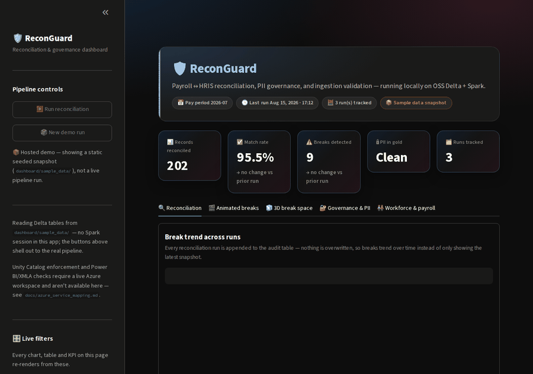

# ReconGuard

**An Azure-native data quality & validation platform for lakehouse pipelines.**

ReconGuard sits on top of a Databricks medallion pipeline and validates every hop — ingestion, transformation, reconciliation, and the reporting layer — with results gated in CI/CD. The pipeline itself is scaffolding. The validation layer is the product.

Most data pipelines treat testing as a few spot-check queries run by hand. ReconGuard treats data validation the way you'd treat application test coverage: reusable, parameterized, versioned, and enforced by a pipeline that refuses to promote data that fails.



---

## Why this exists

Enterprise data breaks silently. An HRIS export and a payroll export disagree on headcount, a transformation drops effective-dated rows, a masked column loses its mask after a refactor, and a Power BI report keeps rendering a number that no longer matches its source. None of these throw an error. They just quietly become wrong.

ReconGuard is built to catch each of those failure modes automatically, on every run, before the data reaches a dashboard.

**Domain:** enterprise HR + payroll. This was chosen on purpose — it carries authentic PII (national IDs, compensation, bank details), which makes the governance and PII-compliance checks real rather than decorative, and it mirrors the kind of ERP/HRIS reconciliation problems that show up in production data platforms.

---

## Architecture

```
        Source systems (simulated)
        ┌─────────────┐   ┌──────────────┐
        │ HRIS extract│   │ Payroll extr.│
        └──────┬──────┘   └──────┬───────┘
               │                 │
        ┌──────▼─────────────────▼───────┐
        │  Azure Data Factory (orchestr.) │
        └──────┬─────────────────────────┘
               │
   ┌───────────▼───────────────────────────────────┐
   │        Azure Databricks — Delta Lake            │
   │                                                 │
   │   Bronze ──▶ Silver ──▶ Gold                    │
   │     │          │          │                     │
   │  [ingest    [transform  [reporting              │
   │   checks]    checks]     checks]                │
   │                                                 │
   │        Unity Catalog (governance / lineage)     │
   └───────────┬─────────────────────────────────────┘
               │
        ┌──────▼──────┐        ┌───────────────────┐
        │  Power BI   │◀───────│ Report validation │
        └─────────────┘        └───────────────────┘

        Everything gated by ▶ Azure DevOps CI/CD
```

- **Ingestion:** raw HRIS and payroll extracts land in **bronze** Delta tables.
- **Transformation:** cleaned, conformed, effective-dated data in **silver**.
- **Serving:** aggregated, report-ready tables in **gold**, exposed to **Power BI**.
- **Governance:** **Unity Catalog** provides column tagging, masking, and lineage.
- **Orchestration:** **Azure Data Factory** runs the pipeline and surfaces monitoring state.
- **Enforcement:** **Azure DevOps** runs the full validation suite on every commit.

---

## The validation layer

This is where most of the engineering effort lives.

### 1. Ingestion validation
Schema/contract checks and freshness/completeness gates on bronze, so bad source data fails loudly instead of propagating downstream. Implemented with **Delta Live Tables expectations**.

### 2. Transformation validation
PySpark test suites asserting business rules across silver:
- referential integrity between employee and payroll records
- no orphaned payroll rows
- compensation within policy bounds
- no duplicate effective-dated records

### 3. Reconciliation engine *(centerpiece)*
A parameterized PySpark/SQL module that reconciles the two sources and classifies every break:

| Break type       | Meaning                                          |
|------------------|--------------------------------------------------|
| `matched`        | present and equal in both systems                |
| `missing_left`   | in payroll, absent from HRIS                      |
| `missing_right`  | in HRIS, absent from payroll                       |
| `value_mismatch` | present in both, disagreeing value (e.g. gross pay) |

Results are written to a Delta **audit table** with run metadata, so every reconciliation is queryable and trended over time.

### 4. PII & governance checks
Automated verification that sensitive columns carry the correct Unity Catalog tags and masking policies, plus a lineage view from source to report. Guards against a refactor silently exposing PII.

### 5. Power BI report validation
Reconciles the gold Delta tables against what the Power BI dataset actually returns (via the XMLA endpoint / DAX query), so the report cannot drift from its source. This check is rarely built and is the one that most directly proves report-layer testing.

---

## CI/CD

An **Azure DevOps** pipeline runs on every commit:

1. Unit tests on the PySpark transformation and reconciliation logic
2. DLT expectations + reconciliation checks against a seeded test dataset
3. A pass/fail gate that blocks promotion of failing data

The gate is the thesis made literal: data that fails validation does not move forward.

---

## Project structure

```
reconguard/
│
├── README.md
├── requirements.txt                     # local (OSS Delta + Spark) dependencies
├── pyproject.toml                        # project + tooling config (ruff, pytest)
├── .env.example                          # config template (workspace URLs, catalog names)
├── Makefile                              # setup / generate / test / lint shortcuts
├── .gitignore
│
├── config/
│   ├── settings.yaml                     # catalog, schema, and path names per environment
│   ├── reconciliation_rules.yaml         # keys, tolerances, and columns to reconcile
│   ├── expectations.yaml                 # thresholds for freshness/completeness checks
│   └── pii_policy.yaml                    # sensitive columns → required tags/masks
│
├── data_generator/
│   ├── __init__.py
│   ├── generate.py                       # entry point: writes both source extracts
│   ├── hris_source.py                    # employee master, effective-dated
│   ├── payroll_source.py                 # payroll runs, gross/net pay
│   ├── break_injector.py                 # injects missing rows + value mismatches
│   └── schemas.py                        # source schemas shared by generator + tests
│
├── pipelines/
│   ├── bronze/
│   │   ├── ingest_hris.py                # raw HRIS → bronze Delta
│   │   ├── ingest_payroll.py             # raw payroll → bronze Delta
│   │   └── dlt_bronze.py                 # Delta Live Tables definitions + expectations
│   ├── silver/
│   │   ├── conform_employees.py          # clean, dedupe, effective-date resolution
│   │   ├── conform_payroll.py            # normalize payroll, join keys
│   │   └── dlt_silver.py                 # DLT transforms + expectations
│   └── gold/
│       ├── headcount_by_dept.py          # reporting aggregate
│       ├── payroll_summary.py            # reporting aggregate
│       └── dlt_gold.py                   # DLT serving tables
│
├── validation/
│   ├── __init__.py
│   ├── expectations/
│   │   ├── ingestion_checks.py           # schema/contract, freshness, completeness
│   │   └── thresholds.py                 # loads expectations.yaml
│   ├── reconciliation/
│   │   ├── engine.py                     # core reconcile(): match + classify breaks
│   │   ├── classifiers.py                # matched / missing_left / missing_right / value_mismatch
│   │   ├── audit_writer.py               # writes results + run metadata to audit table
│   │   └── report.py                     # human-readable break summary
│   ├── pii/
│   │   ├── tag_checks.py                 # verifies Unity Catalog tags present
│   │   ├── mask_checks.py                # verifies masking policies applied
│   │   └── lineage.py                    # source→report lineage extract
│   └── reporting/
│       ├── xmla_client.py                # queries Power BI dataset via XMLA/DAX
│       └── report_reconcile.py           # gold Delta vs. Power BI result comparison
│
├── tests/
│   ├── conftest.py                       # local SparkSession fixture, seed data
│   ├── unit/
│   │   ├── test_break_injector.py
│   │   ├── test_classifiers.py
│   │   ├── test_engine.py                # reconciliation logic, edge cases
│   │   └── test_thresholds.py
│   ├── integration/
│   │   ├── test_bronze_to_silver.py
│   │   ├── test_reconciliation_end_to_end.py
│   │   └── test_pii_checks.py
│   └── fixtures/
│       ├── hris_sample.json
│       └── payroll_sample.json
│
├── adf/
│   ├── pipeline_reconguard.json          # ADF pipeline definition
│   ├── linkedservices/
│   │   ├── ls_databricks.json
│   │   └── ls_storage.json
│   └── triggers/
│       └── daily_trigger.json
│
├── .azure-pipelines/
│   ├── ci.yml                            # lint + unit tests on every commit
│   ├── validation-gate.yml               # DLT + reconciliation gate before promotion
│   └── templates/
│       └── run-pytest.yml                # reusable test step
│
├── notebooks/
│   └── exploration.ipynb                 # ad-hoc profiling (not part of the pipeline)
│
├── scripts/
│   ├── setup_unity_catalog.py            # creates catalog, schemas, tags
│   └── run_local.py                      # runs the full flow on local Spark
│
├── dashboard/                            # Streamlit UI (not part of the pipeline; also the hosted demo)
│   ├── app.py                            # page layout, KPIs, tabs
│   ├── charts.py                         # Plotly figure builders
│   ├── theme.py                          # design tokens + CSS
│   ├── data.py                           # Spark-free reads of the local Delta tables
│   ├── sample_data/                      # committed snapshot, used when data/ or PySpark is absent
│   └── requirements.txt
│
└── docs/
    ├── architecture.md                   # diagram + component walkthrough
    ├── data_model.md                     # bronze/silver/gold + audit-table schemas
    ├── reconciliation_design.md          # break taxonomy + classification logic
    ├── azure_service_mapping.md          # local OSS equivalent → Azure service, per feature
    └── gaps.md                           # what's simulated / partial, and why
```

---

## Getting started

### Option A — real Azure (recommended for the visual proof)
1. Spin up an **Azure free trial** ($200 credit) and a Databricks workspace.
2. Create the smallest single-node cluster.
3. Enable Unity Catalog and load the seed data.
4. Run the ADF pipeline; watch the validation gate.

### Option B — local
Run the core on open-source **Delta Lake + Spark** locally:
```bash
pip install -r requirements.txt
python data_generator/generate.py
pytest tests/
```
The reconciliation engine, DLT-equivalent expectations, and PII checks all run locally. Unity Catalog and the Power BI XMLA check require the Azure workspace.

### Dashboard — the console

A local Streamlit console reads the Delta tables `run_local.py` writes. It's the local stand-in for the Power BI report layer, and the place the validation results become explorable:

- **Live filters in the sidebar** — runs in view, departments, break types, a minimum |pay variance| threshold, and an only-breaks toggle. Every KPI, chart and table on the page re-renders from the same filtered frames.
- **KPI cards with deltas** — records reconciled, match rate, breaks detected, PII-in-gold status and runs tracked, each compared against the prior run.
- **Reconciliation views** — the stacked break trend across runs, the latest run's composition bar, and a drill-down table of individual breaks (payroll gross vs HRIS-expected, styled by status).
- **Animated views** — press ▶ Play and the break composition and the per-record payroll-vs-expected scatter replay run by run (native Plotly `animation_frame`).
- **3D break space** — every reconciled record as a point in expected-pay × payroll-gross × |variance| space (drag to rotate, scroll to zoom; matched records hug the floor, mismatches rise out of it), plus a department × break-type surface of break counts.
- **Governance & workforce tabs** — the sensitive-column policy and real PII-in-gold checks, the ingestion validation gate against the bronze tables, and headcount / average-salary / payroll aggregates by department.

The console uses a gradient glass-dark theme and opens without a Spark session (it reads Delta via `deltalake`, not PySpark); the sidebar's **Run reconciliation** / **New demo run** buttons shell out to `scripts/run_local.py` when you want fresh data.

```bash
pip install -r dashboard/requirements.txt   # or: make dashboard-setup
make run                                    # populate data/, at least once
make dashboard                              # or: streamlit run dashboard/app.py
```

**Hosted demo:** deployed at Streamlit Community Cloud, main file `dashboard/app.py`, requirements `dashboard/requirements.txt`. PySpark isn't in that requirements file (too heavy for a read-only dashboard, unreliable on the free tier), so the hosted version disables the pipeline buttons and reads a static snapshot committed at `dashboard/sample_data/` instead of a live run — see [docs/gaps.md](docs/gaps.md).

---

## Honest gaps

This is a portfolio build, not a production system. Where something is simulated or partial, it's documented rather than papered over:

- **Source systems are simulated.** The HRIS and payroll extracts are generated with deliberately injected breaks, not pulled from a real Workday/PeopleSoft instance.
- **Unity Catalog & DLT require a real workspace.** In the local path these are approximated with OSS Delta Lake and standalone expectation checks; the Azure-service mapping for each is documented in `docs/`.
- **Power BI validation** requires a Power BI workspace with XMLA read enabled; the local path validates the gold Delta tables directly and documents the equivalent report-layer assertion.
- **Scale is representative, not enterprise.** Volumes are sized to demonstrate correctness of the checks, not throughput.

---

## What this demonstrates

Reconciliation, data quality checks, ingestion/transformation validation, PII and governance enforcement, report-layer testing, and a CI/CD gate — built on Databricks, Delta Lake, Delta Live Tables, Unity Catalog, Azure Data Factory, Power BI, and Azure DevOps, in Python, PySpark, and SQL.

The through-line: data testing as a first-class engineering discipline, not an afterthought.
